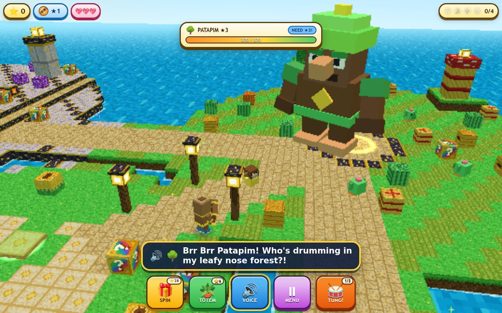

# Tung Tung Tung Sahur 3D: Brainrot Rhythm Island!

A joyful, kid-friendly, 100% English-voiced 3D Three.js r170 WebGL toy-island adventure starring **Tung Tung Tung Sahur** and his viral Italian/Indonesian Brainrot buddies:
- **Tung Tung Tung Sahur** — Expressive 3D warm-teakwood kentungan log hero with bouncy blue sneakers and a 3-beat rhythmic `"TUNG! TUNG! TUNG! SAHUR!"` combo (`8.5 -> 10.8 blocks/s`).
- **4 Hub Sleepy Sahur Cottages / Drum Totems** (`Cappuccino Cafe`, `Banana Treehouse`, `Cactus Oasis Clock`, `Sneaker Beach Hut`) waking up **Ballerina Cappuccina**, **Chimpanzini Bananini**, **Lirili Larila**, and **Cappuccino Assassino** (`Tier 0 -> Tier 3 Ultimate Golden Sahur Tower`).
- **Golden Sahur Drum Roulette Wheel** — Strictly non-downgrading picture roulette progression across 5 wacky Sahur Drum-Clubs (`Wooden Kentungan Bat -> Bronze Temple Gong -> Golden Sahur Mallet -> Neon Thunder Taiko Drum -> Rainbow Mega Sahur Hammer`).
- **4 Giant 3D Brainrot Bosses**:
  1. **Tralalero Tralala** (`★1`, 3-legged blue shark in 3 bright blue sneakers)
  2. **Bombardiro Crocodilo** (`★2`, twin-propeller green plane crocodile)
  3. **Brr Brr Patapim** (`★3`, leafy nose-forest treant troll)
  4. **Golden Sahur Titan King** (`★4`, crowned golden Kentungan King)
- **Zero-Death Cappuccino Foam Cloud `BOING!`** — Early under-geared pokes bounce Tung Tung safely back to the Sunrise Sahur Plaza on a 3D Cappuccino Foam Spring Cloud with `+3` bonus Golden Drum Stars!
- **68 Neural `edge-tts` English Voiceover Clips** (`assets/voice/*.mp3` + `manifest.json`) with `-6.0 dB` WebAudio BGM ducking and 1-tap replay.

## Play Online
- Live GitHub Pages: https://kunruiw1991.github.io/tung-tung-sahur-3d/

